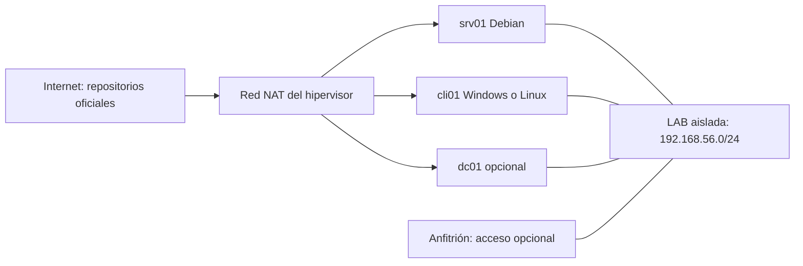

# Laboratorio común de SMR

[Índice](../README.md) · [Diagnóstico](metodo-de-diagnostico.md) · [Plantilla de memoria](../recursos/plantillas/memoria-practica.md)

## 1. Objetivo y alcance

Este laboratorio permite practicar instalación, administración, resolución de nombres, servicios y recuperación sin alterar la red del centro o de casa. Una instalación correcta debe ser explicable y recuperable: conocerás qué VM ejecuta cada servicio, qué interfaz utiliza, qué archivo se modifica y cómo volver al estado anterior.

Se utilizan **Debian 13**, **Windows 11 Pro** y, para las prácticas de directorio de Microsoft, una VM independiente de **Windows Server 2025** con licencia o evaluación legítima. Linux puede administrarse sin escritorio. Los ejemplos son transferibles a otras versiones, pero los nombres de paquetes, rutas, servicios y opciones se deben contrastar con su documentación.

Las especificaciones de VM siguientes son una propuesta de trabajo. No sustituyen los requisitos mínimos oficiales del fabricante ni garantizan rendimiento en cualquier anfitrión. Activa virtualización de hardware en el firmware si tu equipo la admite y comprueba la compatibilidad con el hipervisor. Una VM de Windows 11 debe cumplir los requisitos de CPU, firmware y seguridad que exija Microsoft; utiliza un hipervisor que proporcione TPM virtual y arranque seguro cuando corresponda.

## 2. Topología y asignación de funciones



| Elemento | Propuesta de recursos | Dirección en LAB | Uso |
| --- | --- | --- | --- |
| `srv01` | 2 vCPU, 2–4 GiB RAM, 30 GiB disco | `192.168.56.10/24` | Debian, DNS BIND, Kea DHCP, SSH, web o Samba independiente según práctica |
| `cli01` | Linux: 2 vCPU y 2–4 GiB; Windows: recursos compatibles, preferiblemente 8 GiB RAM y 80 GiB de disco | `192.168.56.20/24` en pruebas estáticas | Cliente que verifica acceso y resolución |
| `dc01` opcional | Windows Server: 2–4 vCPU, 4–8 GiB RAM, 60 GiB o más | `192.168.56.11/24` | AD DS y su DNS; alternativa independiente Samba AD DC |
| Cliente DHCP temporal | Según SO cliente | Rango propuesto `192.168.56.100–150` | Comprobar concesiones; sustituye o clona el cliente, con identidad propia |
| Anfitrión | Depende del equipo | Dirección de la red virtual si se utiliza host-only | Consola del hipervisor y acceso a las VMs |

El servidor de dominio es un escenario separado. No instales simultáneamente en `srv01` BIND, el DNS interno de Samba AD y el DNS de Windows intentando usar la misma dirección y puerto. Las prácticas indican qué servicios deben estar activos. Si dispones de poca RAM, trabaja con dos VMs y realiza los escenarios de directorio en otra sesión.

La red LAB es **host-only** o una red interna del hipervisor. Host-only permite acceder desde el anfitrión; una red interna puede aislar también ese acceso. Ninguna proporciona automáticamente un router. Si el anfitrión usa `192.168.56.1`, esa dirección no debe declararse puerta de enlace salvo que se haya configurado realmente como router. Las comunicaciones dentro de `/24` no necesitan gateway.

## 3. Red NAT y red LAB: responsabilidades distintas

Cada VM puede tener una NIC NAT para descargar actualizaciones y otra NIC en LAB. El hipervisor ofrece la puerta de enlace y el DHCP de NAT; no se copian esos parámetros a LAB. La NIC LAB tiene dirección estática o recibe una concesión del servicio de la práctica. Desactiva el DHCP integrado del hipervisor **en LAB**, de modo que no compita con Kea. Mantén el DHCP de NAT si lo necesitas para Internet.

Desactiva cualquier reenvío de puertos que no forme parte del ejercicio. No conectes la NIC donde pruebas DHCP mediante modo puente a la red física. El modo puente coloca a la VM en esa red y permite que sus servicios afecten a otros equipos. Para VLAN o routing avanzado crea una topología virtual específica con switches y router que implementen esas funciones; un host-only ordinario no demuestra por sí mismo etiquetado 802.1Q.

Nombres utilizados en las guías:

| Parámetro | Valor de ejemplo | Comprobación necesaria |
| --- | --- | --- |
| NIC LAB en Linux | `ens19` | Descubrir el nombre real; también puede ser `enp0s8` u otro |
| NIC NAT | La asignada por el hipervisor | Identificar la que tiene la ruta por defecto |
| Zona DNS de servicios | `aula.test` | Crear realmente la zona antes de usar nombres |
| Servidor de servicios | `srv01.aula.test` → `.10` | Consultar al DNS que corresponda |
| Dominio de directorio | `ad.aula.test` | Resolver con DNS de `dc01`, con registros SRV |
| Zona IPv6 de documentación | `2001:db8:56::/64` en ejemplos | Prefijo documental, sin conectividad pública |

`.test` está reservado para pruebas; consulta [RFC 2606](https://www.rfc-editor.org/rfc/rfc2606). Para un despliegue real utiliza una estrategia de nombres y certificados controlada por la organización. Los dominios de ejemplo no habilitan certificados públicos ni servidores de correo de Internet.

## 4. Preparación por fases

### Fase A: instalar y registrar

Descarga las imágenes desde fuentes oficiales: [Debian](https://www.debian.org/distrib/), [Windows](https://www.microsoft.com/software-download/windows11) y [centro de evaluación de Windows Server](https://www.microsoft.com/evalcenter/). Comprueba firma y sumas según las instrucciones del distribuidor. Comparar un hash con uno obtenido del mismo archivo descargado no verifica autenticidad: necesitas el valor o firma publicado por una fuente de confianza.

Crea las VMs con discos virtuales nuevos e identifica claramente el almacenamiento. Antes de seleccionar un disco en el instalador, contrasta capacidad y función con la configuración de la VM. El procedimiento de particionado de laboratorio no se aplica a discos físicos del equipo anfitrión. Guarda usuario administrativo, versión y configuración fuera del repositorio; las contraseñas van en un gestor, no en la memoria pública.

En Debian instala una cuenta ordinaria y un mecanismo de administración. Si `sudo` no está instalado o la cuenta no pertenece al grupo autorizado, usa la consola administrativa y el procedimiento oficial para prepararlo. Escribir `sudo` delante de un comando no crea permisos. En Windows distingue terminal ordinaria y terminal elevada; la administración del sistema y de AD requiere permisos distintos según tarea.

### Fase B: identificar interfaces y estado

Comandos **de consulta** en Linux:

```bash
cat /etc/os-release
ip -br link
ip -br address
ip route
ip -6 route
timedatectl status
```

`ip -br link` enumera interfaces y estado; `ip -br address` añade direcciones; `ip route` muestra dónde se envía tráfico fuera de la subred. Es esperable una ruta por defecto hacia NAT y una ruta conectada a `192.168.56.0/24` por LAB una vez configurada. Anota el nombre real de LAB antes de sustituir `ens19` en cualquier servicio.

Comandos **de consulta** en PowerShell:

```powershell
Get-ComputerInfo | Select-Object WindowsProductName, WindowsVersion, OsBuildNumber
Get-NetAdapter | Select-Object Name, Status, LinkSpeed
Get-NetIPConfiguration
Get-NetRoute -AddressFamily IPv4 | Sort-Object RouteMetric
Get-DnsClientServerAddress -AddressFamily IPv4
Get-Date
```

Windows 11 Home no sirve para todas las prácticas de unión a un dominio AD. La edición y el estado de activación deben ser adecuados para la actividad y su licencia. Documenta la versión realmente utilizada, aunque difiera de la propuesta.

### Fase C: configurar LAB

Utiliza el gestor de red que ya administra la interfaz: NetworkManager, `ifupdown` o `systemd-networkd`, según la instalación. No actives varios gestores para la misma NIC. Establece `.10/24` para `srv01` y `.20/24` para `cli01`, sin gateway en LAB. En la VM del dominio usa `.11/24`. Haz el cambio desde la consola del hipervisor si puede cortar tu acceso remoto.

Antes de configurar DNS propio puedes mantener la resolución de Internet que ofrece NAT para instalar paquetes. Después, comprueba explícitamente qué resolutor usan las aplicaciones: tener dos NIC puede introducir prioridades y sufijos distintos. En las pruebas de BIND se consulta directamente `192.168.56.10`; en las pruebas de AD se usa el DNS del controlador de dominio. Un DNS público no contiene los registros de tu laboratorio AD.

No conviertas `srv01` en router por tener dos tarjetas. Reenviar IP es una función que requiere configuración, reglas y objetivo explícitos. Tampoco habilites una segunda puerta por defecto para «arreglar DNS»: son problemas diferentes.

### Fase D: obtener una línea base

Comprueba en ambos sentidos conectividad y acceso al servicio que realmente necesitas. ICMP puede estar filtrado; un ping fallido no prueba por sí solo una avería del equipo. Para empezar, observa:

```bash
ip route get 192.168.56.20
ping -c 3 192.168.56.20
ip neigh show
```

En Windows:

```powershell
Test-NetConnection 192.168.56.10
Test-NetConnection 192.168.56.10 -Port 22
```

La prueba TCP al puerto 22 sólo debe funcionar después de instalar y autorizar SSH. Antes de eso, conexión rechazada puede demostrar que se llega al equipo pero falta el listener. Un timeout puede tener distintas causas y se investiga con rutas, cortafuegos y captura.

## 5. Instantáneas, clones y copias

Crea una instantánea `00-instalacion-limpia` después de verificar el sistema, otra `01-lab-estatico` tras configurar red y otras antes de cambios importantes. Registra qué contiene cada una. Una instantánea depende normalmente de los discos y archivos de la VM original: no es una copia independiente ni reemplaza la estrategia de backup.

Al clonar un cliente genera una MAC y una identidad de sistema adecuadas al hipervisor y al SO. Dos clones con la misma dirección estática o identidad DHCP pueden producir síntomas intermitentes. La clonación y recuperación de controladores de dominio requiere procedimientos específicos del directorio; no se enseña a restaurar indiscriminadamente una instantánea antigua de AD como sustituto del backup del estado del sistema.

Exporta o respalda el laboratorio a un destino separado cuando la práctica de recuperación lo requiera. Verifica que puedes leer los archivos y restaurar al menos un conjunto pequeño. Conserva la fecha, la versión, los pasos de recuperación y los tiempos medidos. Las credenciales y los discos virtuales no se incorporan a Git.

## 6. Conflictos previsibles entre prácticas

| Conflicto | Síntoma habitual | Resolución |
| --- | --- | --- |
| DHCP del hipervisor y Kea en LAB | Concesiones con DNS o rango inesperados | Desactivar sólo el DHCP de LAB y observar quién responde |
| BIND y otro DNS en la misma IP:53 | Servicio no arranca o consulta al daemon equivocado | Separar roles/VMs y revisar listeners |
| Nginx y Apache en la misma IP:80 | Error de enlace al arrancar | Usar el servidor previsto o separar IP/puertos |
| IP duplicada en clones | ARP cambia, conectividad intermitente | Direcciones y MAC distintas; revisar concesiones |
| DNS AD sustituido por DNS público | No localiza dominio o Kerberos falla | Consultar DNS del directorio y sus registros SRV |
| Cambio de hora o suspensión larga | Errores de tickets/certificados | Verificar UTC, zona y sincronización con fuentes apropiadas |
| Varios gestores de firewall | Regla aparente sin efecto | Elegir el gestor del ejercicio y revisar las reglas efectivas |
| LAB solapa una VPN/red doméstica | Rutas ambiguas | Elegir otro prefijo privado y adaptar toda la práctica de forma coherente |

## 7. Evidencias mínimas y aceptación

Un laboratorio listo presenta un inventario de VMs, su versión, recursos, direcciones e interfaces. Adjunta el diagrama, tabla de nombres, resultado de rutas y las pruebas necesarias para cada servicio. Una captura de «servicio activo» demuestra el estado del proceso, pero no demuestra que el cliente lo pueda usar.

En cada prueba distingue: preparación, estímulo, resultado esperado, resultado real y conclusión. Añade una prueba negativa, como acceso a un recurso sin permisos, y una recuperación. Para aceptar DNS consulta un registro conocido y otro inexistente; para SMB prueba lectura y escritura por identidades; para backup restaura en otra ruta y compara contenido.

Los procedimientos de las asignaturas son propuestas para ejecutar en este laboratorio. La validación del repositorio comprueba archivos y ejemplos seleccionados, sin afirmar que todas las combinaciones de hipervisor, SO, firmware, cliente y servicio han sido ejecutadas. Registra tus propias pruebas con la [matriz de aceptación](../recursos/plantillas/matriz-de-pruebas.md).

## 8. Referencias técnicas

- [Manual de instalación de Debian](https://www.debian.org/releases/stable/installmanual): instalación y selección del entorno.
- [Debian Reference](https://www.debian.org/doc/manuals/debian-reference/): administración, red y diagnóstico.
- [Microsoft Learn: Windows Server](https://learn.microsoft.com/windows-server/): roles, administración y requisitos por versión.
- [Microsoft: requisitos de Windows 11](https://www.microsoft.com/windows/windows-11-specifications): requisitos de plataforma.
- [VirtualBox User Manual](https://www.virtualbox.org/manual/): modos de red, instantáneas y recursos virtuales.
- [RFC 5737](https://www.rfc-editor.org/rfc/rfc5737) y [RFC 3849](https://www.rfc-editor.org/rfc/rfc3849): direcciones destinadas a documentación.
