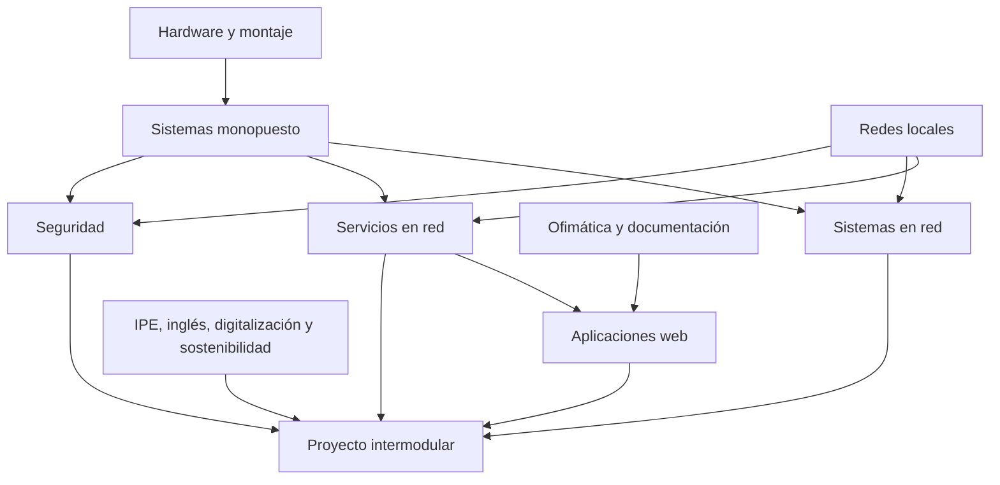

# Ruta de estudio y dependencias

[Índice](../README.md) · [Primero](../primero/README.md) · [Segundo](../segundo/README.md)

## 1. Cómo estudiar una guía técnica

Empieza por identificar el problema que resuelve el tema. Antes de ejecutar un comando, explica qué objeto consulta o modifica y qué evidencia esperas obtener. Después compara el resultado real y revisa tu hipótesis. Memorizar opciones sin entender permisos, rutas o dependencias produce procedimientos frágiles que fallan al cambiar de versión.

Trabaja con un cuaderno de laboratorio. Para cada sesión registra objetivo, estado inicial, cambio, resultado y recuperación. Guarda los archivos de configuración sanitizados y los datos sintéticos junto a tu memoria. Las capturas ayudan, pero un bloque de texto bien identificado permite buscar, comparar y reproducir mejor un resultado.

## 2. Dependencias conceptuales

Las flechas representan dependencias de aprendizaje, no requisitos administrativos de matrícula o promoción. La seguridad debe aplicarse desde primero aunque se profundice en segundo; documentar y comunicarse también atraviesa todos los módulos.

## 3. Primer curso: progresión propuesta

| Hito | Qué estudiar | Evidencia de dominio | Error que debes saber explicar |
| --- | --- | --- | --- |
| 1 · Observar el equipo | Unidades, CPU, RAM, almacenamiento, firmware | Inventario con compatibilidades y mediciones | Confundir capacidad, velocidad, latencia y rendimiento |
| 2 · Instalar un puesto | Arranque UEFI, particiones, SO, actualizaciones | Instalación en VM y mapa del disco | Elegir un disco por un nombre sin comprobar su identidad |
| 3 · Administrar localmente | Usuarios, grupos, permisos, procesos y servicios | Recurso compartido local y prueba de mínimo privilegio | Usar cuenta administradora para ocultar un problema de permisos |
| 4 · Conectar | Ethernet, IP, prefijos, rutas, DNS | VLSM resuelto y laboratorio estático | Cambiar DNS para un problema de cableado o ruta |
| 5 · Documentar datos | Estilos, fórmulas, tablas y bases de datos | Memoria, presupuesto y consultas con resultados contrastados | Confundir formato visible con el valor almacenado |
| 6 · Preparar trabajo profesional | PRL, relación laboral, aprendizaje y portfolio | Evaluación de riesgos y plan de desarrollo | Proponer una medida sin relacionarla con un riesgo |

No asignes duración a un hito sólo por el número de páginas. Repite los ejercicios que revelen una carencia: si no puedes obtener red y broadcast de un `/27`, el problema reaparecerá al configurar DHCP o routing. Si no puedes explicar propietario, grupo y ACL, la administración de Samba o NTFS resultará confusa.

## 4. Segundo curso: progresión propuesta

| Hito | Dependencia previa | Producto verificable |
| --- | --- | --- |
| 1 · DNS y tiempo | Direccionamiento y resolución básica | Consultas A/AAAA/PTR y registro de sincronización |
| 2 · DHCP y administración remota | Topología aislada y permisos | Concesión válida, identidad del servidor y sesión SSH verificada |
| 3 · Identidades centralizadas | DNS, hora y usuarios/grupos | Dominio o servicio de archivos con matriz de permisos |
| 4 · Web mantenible | HTTP, permisos y base de datos | Sitio accesible con HTTPS, usuarios y restauración |
| 5 · Seguridad y continuidad | Servicios que ya funcionan | Política mínima, registros, backup y recuperación medida |
| 6 · Integración y defensa | Hitos anteriores | Memoria de proyecto y demostración con pruebas positivas y negativas |

El inglés técnico se practica leyendo una sección real de documentación y escribiendo un ticket asociado al laboratorio. La digitalización justifica cómo la solución mejora un proceso, y sostenibilidad mide consumos, vida útil o residuos con hipótesis explícitas. IPE II aporta organización, comunicación y viabilidad económica.

## 5. Técnica de repaso

Después de cada tema redacta cinco preguntas sin mirar la guía: definición, funcionamiento, procedimiento, fallo y decisión. Por ejemplo, en DNS: qué es un registro A, cómo se resuelve un nombre, cómo comprobar una zona, por qué falla una consulta y cuándo separar DNS autoritativo y recursivo. Contesta usando un caso y un comando o evidencia cuando corresponda.

Revisa después de unos días y más tarde tras integrar el tema en otro módulo. Cambia datos del ejercicio: otro prefijo, grupo, ruta o nombre. Si la solución sólo funciona con los valores originales, revisa el concepto que estabas siguiendo de forma mecánica.

## 6. Preparación de evaluaciones prácticas

Practica con tiempo medido y un estado inicial conocido. Lee la consigna completa y reserva tiempo para comprobar el resultado. Una configuración que funciona sólo desde el servidor no cumple un requisito que pide acceso desde un cliente. Entrega los archivos editables y la memoria, junto con los pasos para reproducirla.

Usa las preguntas con soluciones para comparar razonamientos, no únicamente respuestas. Cuando falles, registra si la causa fue conceptual, de lectura, de sintaxis, de entorno o de validación. Cada causa necesita un trabajo distinto: repetir comandos no corrige una comprensión equivocada del direccionamiento.

Las rúbricas del repositorio son instrumentos de autoevaluación. Los instrumentos y criterios académicos concretos los publica el centro. El [proyecto intermodular](../segundo/proyecto-intermodular/README.md) permite reunir evidencias, y la [formación en empresa](formacion-en-empresa.md) exige adaptarlas a procedimientos y confidencialidad reales.
