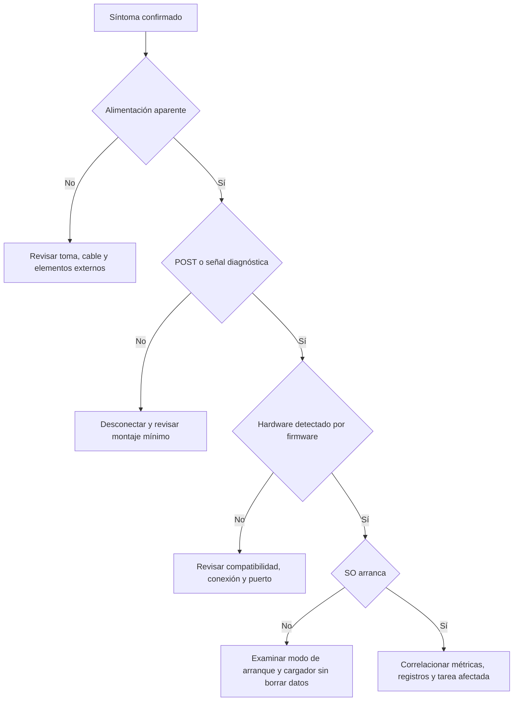

# 04 · Diagnóstico y evaluación razonada

[Volver al módulo](README.md)

## 1. Árbol de decisión inicial

El árbol decide la siguiente familia de pruebas; no identifica automáticamente una pieza. Un ventilador que gira no demuestra tensiones estables bajo carga. Un pitido o LED se interpreta con el manual exacto, porque los códigos varían.

## 2. Casos frecuentes

| Síntoma | Hipótesis a comprobar | Primera prueba útil | Error a evitar |
| --- | --- | --- | --- |
| No hay vídeo tras cambiar CPU | CPU sin gráficos o firmware incompatible | Comprobar referencias y lista de soporte | Comprar otro monitor sin validar la plataforma |
| Menos RAM de la instalada | Módulo mal asentado, ranura o reserva de hardware | Comparar UEFI y SO; revisar con equipo apagado | Forzar el módulo o tocar contactos |
| Reinicio bajo carga | Temperatura, alimentación, RAM, controlador | Correlacionar tiempos, temperaturas y eventos | Atribuir todo reinicio a la fuente |
| SSD M.2 no detectado | Protocolo o puerto incompatible | Revisar manual y modelo exacto | Suponer que cualquier M.2 es NVMe |
| Disco USB se desconecta | Cable, alimentación, puente o unidad | Cambiar un elemento externo conocido | Ejecutar reparaciones destructivas de inmediato |
| Impresión con manchas periódicas | Consumible o componente del recorrido | Página interna y manual del modelo | Abrir fusor caliente |
| Equipo lento con mucho disco | Paginación, actualizaciones, fallo o carga real | Identificar proceso e I/O durante el síntoma | Medir solo CPU en reposo |

## 3. Cómo interpretar mediciones

Una medición debe incluir unidad, herramienta, instante, carga y configuración. `500` puede ser MB/s, IOPS o milisegundos; sin unidad no permite decidir nada. Las lecturas secuenciales grandes evalúan un comportamiento diferente al de muchos archivos pequeños. Cachés, compresión y datos repetidos pueden inflar un benchmark; declara las condiciones.

Calcula promedios solo después de revisar variabilidad. Si tres copias tardan 20, 21 y 70 segundos, una media de 37 segundos oculta un evento que hay que investigar. Revisa si coincidió con actualización, falta de memoria o lectura problemática. La correlación temporal apoya una hipótesis, pero no prueba causalidad sin controles.

Para evaluar una ampliación compara la misma tarea antes y después. Mantén software, datos, temperatura ambiente y perfil energético cuando sea posible. Si cambias disco, RAM y versión del SO a la vez, puedes demostrar mejora global, pero no asignar cuánto aporta cada componente.

## 4. Preguntas con solución

**1. Una placa tiene HDMI, pero no aparece imagen con una CPU nueva. ¿Está averiada la placa?**

No se puede concluir. Hay que comprobar si esa CPU incluye gráficos, si el firmware la admite y si el monitor está conectado a la salida correspondiente. También se revisa el POST. El conector de la placa puede depender de la GPU integrada en la CPU.

**2. ¿Cuánto equivale un enlace de 1 Gbit/s en MB/s?**

Dividir entre ocho da 125 MB/s decimales como techo de bits convertidos a bytes. El rendimiento de una copia será menor por protocolos, implementación y almacenamiento. No debe confundirse MB con MiB.

**3. Un disco muestra SMART correcto. ¿Se puede eliminar la copia de seguridad?**

No. Los indicadores no anticipan todas las averías ni protegen contra borrado, robo o software malicioso. La copia es un mecanismo independiente y debe probarse mediante restauración.

**4. ¿Son intercambiables dos cables modulares que encajan en la fuente?**

No puede asumirse. El conector externo puede ser físicamente igual y el pinout diferente. Solo deben utilizarse cables cuya compatibilidad esté confirmada por el fabricante para ese modelo.

**5. ¿Secure Boot cifra el disco?**

No. Verifica firmas en una cadena de arranque. El cifrado de volumen es una función diferente. Ambos mecanismos pueden complementarse, pero resuelven problemas distintos.

**6. ¿Por qué un perfil de memoria puede arrancar y fallar horas después?**

La estabilidad depende de patrón de acceso, carga, temperatura, controlador y alimentación. Arrancar usa una fracción de los estados posibles. Se necesita una validación adecuada y, ante errores, volver a la configuración base antes de buscar otra causa.

**7. Una prueba interna de impresora es correcta y la de Windows falla. ¿Qué capa investigar primero?**

Cola, controlador, puerto y conexión. La prueba interna demuestra parte del funcionamiento físico, aunque no descarta absolutamente todo fallo mecánico. Permite priorizar causas sin sustituir consumibles al azar.

**8. ¿Dos módulos DDR5 con ECC interno convierten el equipo en una estación ECC?**

No. La corrección interna de los chips no equivale a la protección del recorrido completo de datos. Hay que verificar soporte explícito de la plataforma y módulos para ECC del sistema.

## 5. Evaluación integradora propuesta

El alumno recibe un síntoma, un inventario incompleto y un límite de tiempo. Debe preparar una intervención, recopilar información, plantear hipótesis, ejecutar pruebas autorizadas y entregar el equipo o explicar una escalada. La calificación didáctica propuesta pondera fundamento técnico (25 %), procedimiento (30 %), evidencia de aceptación (30 %) y documentación (15 %).

La seguridad física, la preservación de datos y el respeto al alcance son condiciones de la práctica. Ante un riesgo real se detiene y se reprograma con el docente. No se compensa una actuación peligrosa con una buena presentación.

## 6. Lista de autoevaluación

- Puedo diferenciar formato, enlace y protocolo de almacenamiento.
- Puedo justificar una configuración con referencias concretas del fabricante.
- Sé identificar el disco y comprobar la recuperación antes de intervenir.
- Distingo diagnóstico, corrección y validación posterior.
- Interpreto métricas con unidades y condiciones de prueba.
- Registro una limitación o prueba no ejecutada sin inventar resultados.
- Puedo explicar la intervención a una persona sin formación técnica.

Si una respuesta es negativa, vuelve al apartado correspondiente y repite una práctica acotada. El objetivo es adquirir un método transferible a equipos distintos, no memorizar una combinación específica de piezas.
